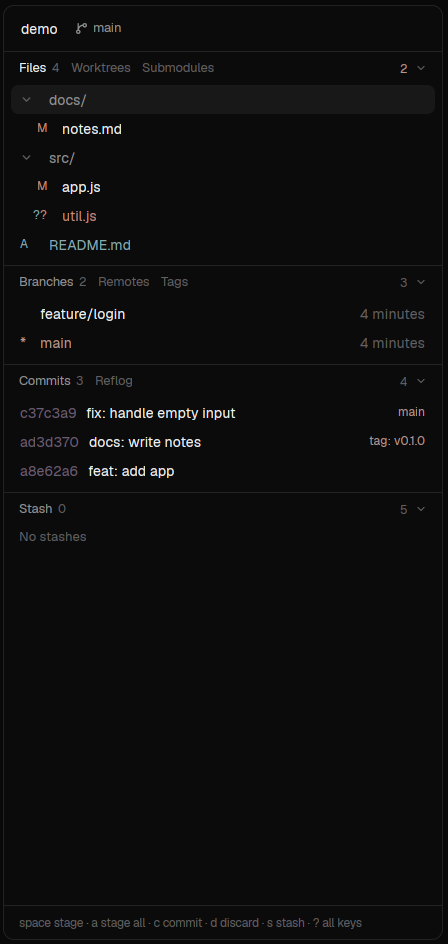

# Smart Git

A [lazygit](https://github.com/jesseduffield/lazygit)-style git panel for Herdr. It lives in the sidebar, works with the keyboard or the mouse, and opens diffs in a pane beside your terminals.



## Features

- **One sidebar card**: a commit box, then Files, Branches, Commits and Stash. Each list has lazygit's tabs (Worktrees, Submodules, Remotes, Tags, Reflog).
- **Diff pane**: select a file, commit, stash or branch and its diff opens next to your terminals. Unified or side by side, whole-file view, a file panel for commits, and a `git log --graph` for branches.
- **Line-level staging**: select lines with `v`, stage them with `space`. You can also discard lines, or move lines out of a commit.
- **Conflict resolution**: `Keep ours · Keep theirs · Keep both` links on every conflict, and `h`/`l` to move between conflicts.
- **History rewriting**: reword, squash, fixup, drop, interactive rebase, cherry-pick, bisect, and undo from the reflog. Anything that can't be undone asks first.
- **Agent-written commit messages**: press ✨ (or `I`) and an agent CLI you already have installed (Claude, Codex, Copilot, Amp, ...) writes the message in your repo's style. Right-click ✨ to pick the agent and model.
- **Submodules**: step into one, commit, and step back out, with a breadcrumb to show where you are.
- **Follows your terminal**: switches to the repo of the focused terminal's folder, including remote spaces.

## Keys

Lazygit's defaults. Press `?` for the full list, or right-click any row for a menu of its actions.

| Key | Action |
| --- | --- |
| `j` `k` | move |
| `h` `l` | previous / next section |
| `1`–`5` | jump to a section |
| `[` `]` | switch tab |
| `/` | filter the list |
| `space` | stage / unstage, check out, apply |
| `c` | focus the commit box |
| `I` | agent writes the commit message |
| `enter` | zoom the diff to stage lines |
| `p` `P` `f` | pull, push, fetch |
| `r` `s` `f` `d` | reword, squash, fixup, drop (on a commit) |
| `C` `V` | copy / paste for cherry-pick |
| `z` | undo from the reflog |
| `?` | all keys |

## Install

Copy `mods/smart-git` into Herdr's mods folder, then open it with `mod.open:smart-git`, or put it in your layout as a block:

```json
{ "id": "changes", "type": "block", "content": { "mod": "smart-git" } }
```

Needs `git` 2.25 or newer and `sh`. "Open in browser" needs `xdg-open`.

## Credits

Inspired by [lazygit](https://github.com/jesseduffield/lazygit) (MIT, © Jesse Duffield). Keybindings follow lazygit's defaults.

## License

[MIT](LICENSE)
