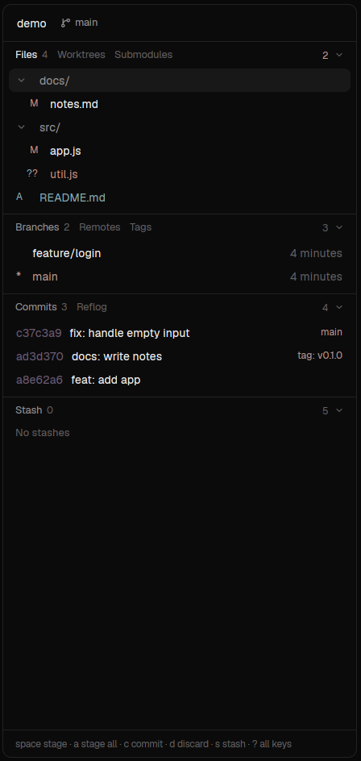

# Smart Git

All of lazygit, inside Herdr's sidebar, with the mouse as well as the keys. Pick a file, commit or branch and its diff opens in a pane beside your agents; stage single lines, rebase, cherry-pick, bisect and undo without leaving the window. Your own coding agent writes the commit message (Claude, Codex, Copilot, Amp and any other installed agent), and submodules are first-class: step into one, commit, and step back out.

The sidebar is one card: a title bar (repo and branch), a VS Code-style commit box, then Files, Branches, Commits and Stash, each with lazygit's tabs (Worktrees, Submodules, Remotes, Tags, Reflog). Every action is a lazygit key on the focused list or a right-click menu.

## What you see

**Sidebar card** (rounded 10px, 1px `border`, `background` fill, text 13px), top to bottom:

1. **Title bar**, 42px, bottom border. Repo name in semibold. Inside a submodule it becomes a breadcrumb `repo › sub › subsub`; clicking an earlier crumb goes back out. Then a 22px branch chip (git-branch icon, branch or short hash when detached, `↑n` in `ansi2`, `↓n` in `ansi1`). Far right: a spinner (`.frames` braille, `working` color) with the running action's label, e.g. "Staging…".
2. **Commit box**, as VS Code's: a card 10px in from the sides (8px above, 6px below), rounded 8px, 1px `border` (`accent` while you type in it), 12.5px text. A 32px line holds the subject input (placeholder "Commit message"), then two 24px icon buttons rounded 5px (`muted`, `hover` background): ✨ (`sparkles.svg`, 13px; a `working` braille spinner while the agent writes) and ✓ (`check.svg`, enabled once there's a subject). Under it, once there is a subject, a 1px `border` line and a "Description" textarea that grows from 2 to 6 lines. The unsent subject and description are kept per repo. Hidden when there's no repo.
3. **Banners**, 11.5px rows under the title, only when relevant: `Rebasing` / `Merging` / `Cherry-picking` / `Reverting` / `Bisecting` (`blocked` color, with "· n conflicted" and hint "m continue / abort"), "n copied for cherry-pick" (`accent`), "Diffing against <ref>", "Commits touching <path>", transient info text.
4. **Four sections** that share the height and are all open by default, never an accordion. Each has a 30px header: tab labels 11.5px medium (active tab `foreground` when the section is selected, `muted` when not, others `dim`), the active tab's row count after its label, then a clickable strip that folds the section (shows the selected row's name when folded, the section number 2-5 in `accent` if selected, chevron). Sections: `Files | Worktrees | Submodules`, `Branches | Remotes | Tags`, `Commits | Reflog`, `Stash`. A section sizes to its rows, at least 3 rows tall, and shares leftover height; a 1px top border separates sections.
5. **Rows**, 26px, 8px side padding, radius 7, selected row `selected` while the list has the keyboard, `hover` otherwise. Per tab:
   - Files: one unified tree (no Staged/Changes split). Folder rows with chevron (green when all staged, `blocked` when some, `dim` when none). File rows: two-character status (index in `ansi2`, worktree in `ansi1`, `?` for untracked), name in `ansi2` when fully staged, `ansi1` when conflicted or untracked. 12px indent per depth. A submodule row says `submodule: commit, modified, untracked`.
   - Branches: `*` for current in `accent`, name, `↑n ↓m` upstream track, relative age with " ago" cut.
   - Commits: short hash (`ansi3`, `ansi1` for unpushed, `accent` plus `◆` if copied), subject, ref decorations in `accent` 11px (max 110px, `HEAD -> ` removed). During an interactive rebase the list shows the todo: action word in 11px semibold (`pick` `ansi2`, `drop` `ansi1`, others `blocked`), hash, subject.
   - Reflog, Stash (`{n}` then subject), Tags (name, subject, age), Remotes (name, url; enter opens its branches), Worktrees (`*` on the one you are in, branch, `~` path), Submodules (state mark, nested ones indented, `not checked out` in `dim`).
6. A red note line (click to dismiss) when an action fails; a 10.5px `dim` hint line at the bottom with the first six keys of the current list and `? all keys`.

**Diff pane**, a normal Herdr pane titled `smart-git`: a header with the selection's title and two icon buttons (wrap, split/unified), a virtualized, scrollable list of 20px rows, and a hint line. Unified by default, side by side with `s`. Green/red added/removed lines, `@@` hunk headers, file headers with their `+n −m`, and for a branch a `git log --graph`. A commit, stash or range lists its files (lazygit's `--stat`, counted from the diff's own rows, no extra git call): a panel left of the diff (240px by default; drag its 5px edge between 160px and 40% of the pane, under 120px it closes and a list button on the pinned bar reopens it, double-click resets; kept in `smart-git:panelW`), shown only while the diff beside it keeps 900px (520px when unified), so side by side in auto never gives way to it (header "n files +a −d", 24px rows: status letter A/M/D/R/C, file name, folder `dim`, `+n −m`); otherwise the same list drops down over the diff from the pinned bar. The pinned bar (26px, `surface`, above the rows) names the file at the top of the list (letter, folder `dim`, name semibold, counts, `n/N`), or "n files changed +a −d" above the first file; the panel highlights that file (`selection`). Clicking a file puts its header at the top and the cursor on its first change. Scrolling doesn't redraw the view, so a 100ms timer redraws when the top file changes. Diffs cut at 20000 lines say their counts are partial. A commit opens with one meta row (`--format=meta %h%x1f%D%x1f%an%x1f%ar%x1f%p`, refs as the graph's labels from `--decorate=full`, author in their graph color, relative date, "merge" for merges), then the message unindented, subject semibold, trailers (`*-by:`, `Change-Id:`) `dim`, one blank row before the first file. Shows "Select something in the git panel" until something is selected.

## How it behaves

- Follows the focused terminal's folder (and its machine, for remote spaces). Finds the repo root and every superproject above it. A tab with only mods keeps the repo it has. Not a repo: "Not a git repository".
- Refreshes on a folder watch (local repos), every 10 seconds, and after each action.
- **Commit box:** Enter in the subject commits (ctrl-enter from the description), tab/shift-tab move between the two fields, esc gives the keys back to the list. With nothing staged it asks, then commits everything. After a commit both fields empty.
- **Agent-written messages:** ✨ (or `I`) sends the staged diff (everything when nothing is staged, cut at 10,000 characters), the file list, the branch and the last 10 subjects to an agent CLI, which answers with JSON `{subject, body}`; the subject follows the repo's own style. Right-click ✨ (or `ctrl-i`) opens the picker: **Auto** (the agent most recently busy in this space, else the one you pick most, with its fast model), every agent Herdr knows is installed (then its model, listed live from the CLI when it can print them), or a custom command. An agent without a built-in recipe asks once for the arguments that make it answer one prompt. The ✨ tooltip names the agent in use.
- **Selecting a row** (arrows, click) shows it in the diff pane (sent after a 60ms rest so a held key only sends where it stops). The first selection splits the diff pane right of the focused pane, once per tab.
- **Mouse:** click row selects; double-click runs space (Files, Branches, Worktrees) or enter (others); a folder toggles on one click; click a tab label switches tab; click the header strip folds; right-click a row selects it and opens a popup menu of that list's actions; right-click the branch chip opens the menu of all keys.
- **Keys** (sidebar focused; lazygit's defaults, no `keys.json`): `j/k/up/down` move, `ctrl-d/u` and page keys move 10, `home`/`end` first/last (not `g/G`: `g` is reset or pop), `h/l` (also left/right, tab/shift-tab) previous/next section, `1`-`5` jump to a section (1 is the title bar's branch chip, 2-5 the four sections), `[`/`]` switch tab, `/` filters the list (input under the header, esc clears), `x` opens the current list's menu, `?` lists every key.
  - Files: `space` stage/unstage, `a` all, `c` puts the keyboard in the commit box, `I` has an agent write the message, `ctrl-i` picks that agent, `w` commit without hooks, `d` discard (menu), `D` reset options, `M` resolve conflict, `s`/`S` stash, `i` ignore, `e` edit, `o` open, `` ` `` tree/flat, `-`/`=` collapse/expand all, `enter` zooms the diff pane to stage lines.
  - Branches/Remotes/Tags: `space` check out, `enter` log, `n` new, `d` delete, `R` rename, `u` upstream, `f` fast-forward, `M` merge into current, `r` rebase onto, `W` diff against this, `o` open in browser (forge URL from the remote).
  - Commits: `r` reword, `s` squash, `f` fixup, `d` drop, `e` edit, `i` interactive rebase from here, `ctrl-j/k` move down/up, `A` amend with staged, `F` create fixup, `S` squash fixups, `t` revert, `C`/`V` copy and paste for cherry-pick, `g` reset to this, `n` branch, `T` tag, `b` bisect, `ctrl-s` filter by path, `y` copy, `o` browser. Rewrites are single-shot (`rebaseWith`); while a rebase is running the todo list is editable.
  - Submodules: `enter` goes into it (breadcrumb), `u` update, `i` init, `n` add, `e` edit URL, `d` remove, `b` bulk menu, `y` copy path, `o` terminal there.
  - Worktrees: `enter`/`space` switch, `n` new, `d` remove, `o` terminal. Stash: `space` apply, `g` pop, `d` drop, `n` branch, `r` rename.
  - Everywhere: `p` pull, `P` push, `f` fetch all, `z` undo from reflog, `R` refresh, `m` continue/abort an operation in progress. Destructive actions ask first.
- **Diff pane keys** (focused): `j/k` line, `g/G` ends, `v` range, `a` hunk, `s` split/unified, `w` wrap, `ctrl-w` ignore whitespace, `{`/`}` context lines (default 3), `f` whole file (opens every gap: a `⋯ n unchanged lines` bar before each hunk and one for the rest of the file; clicking one opens or folds just it, `⌃ hide` once open), `S` submodule log/diff, `z` zoom, `esc`/`q`/`h` back to the sidebar. On a file: `space` stages/unstages the selected lines or hunk, `d` discards them. On a commit: `space` moves the selected lines out of it. On a conflicted file: `j/k` next conflict, `h/l` ours/theirs, `space`/`enter` take it, `b` both, `z` undo.
- Agent statuses are not used by this mod; it only reacts to git state.
- State shared across copies: folded sections, active tabs, tree/flat, split/wrap/whitespace/context/whole file (`smart-git:*` shared keys), so the sidebar and diff pane agree and survive restarts.

## Built from

Files in `mods/smart-git/`:
- `mod.json`: `{ "place": "none", "title": "git", "focusable": true }`. `focusable` lets `pane.go` reach it and sends `"focus"` through `nextCommand()`.
- `main.js` (default `HerdrGit extends View`): `init` picks a part by `props().view`: `"diff"` → `Diff`, `"ask"` → `Ask` (dialogs), otherwise `Sidebar`. Sidebar holds the `PANELS` table, one action table `actions(cx)` per list (used by keys, right-click menus, `?` and the hint line), `follow`, `refresh` (parallel `git` reads, status via `STATE` shell snippet for rebase/merge/bisect markers), and `render`.
- `diff.js`: `Diff` part, one `v_virtual_list` of rows from `diffRows`/`splitRows`; selection arrives through `shared("smart-git:show")`; line staging builds a patch with `partialPatch` and applies it; conflicts via `parseConflicts`.
- `git.js`: `location()`, `git(repo, args, {write, timeout, env})` (reads add `--no-optional-locks` and disable fsmonitor/auto-refresh so a refresh never triggers the folder watch; every call is `env GIT_TERMINAL_PROMPT=0 GIT_EDITOR=true git …`), `writeThere` (writes via `sh -c 'printf %s "$1" > "$2"'` in 30000-char pieces), `findRoot`, `parse*` for status v2, log, branches, submodules, worktrees, remotes, refs, reflog, stash, and `rebaseWith` (a `GIT_SEQUENCE_EDITOR` that applies one change to a todo).
- `ask.js`: `ask(spec)` opens `openOverlay({mod:"smart-git", kind:"popup"|"dialog", props:{view:"ask", id, ...spec}})` and resolves a promise from module scope; `confirm`; `keyOf(event)` spells keys the lazygit way (`a`, `A`, `space`, `ctrl-d`). Specs: `{items:[{key,label,value,danger}], menu, title, detail, input, description}`; menus are 300px wide, dialogs 460px.
- `agent.js`: agent-written commit messages. `RECIPES` (how each agent in `knownAgents` answers one prompt: args with `{prompt}`, model flag, models or the args that list them, fast model), `writeMessage(repo, files, branch, agent)` → `{subject, body}`, `savedAgent()` / `chosenAgent(on)` (saved choice in `smart-git:agent`, else Auto from `agents()`), `pickAgent(on)` (the agent and model picker; set-ups saved in `smart-git:recipes`).
- Icons: `align-left.svg`, `columns-2.svg`, `rows-2.svg`, `wrap-text.svg` (14px, `svg("mods/smart-git/<name>.svg")`) for the diff header; chevron-right, chevron-down and git-branch come from the shipped `mods/workspace-chrome/*.svg`.

From `gpui-kit`/`gpui-base`: `View, div, svg, v_flex, h_flex, Scrollbar, ScrollHandle, InputState, Input, EditorState, Editor, v_virtual_list, VirtualListScrollHandle`. From `herdr`: `props, panes, focused, spaces, theme, settings, run, shared, setShared, watchFolder, nextCommand, exec, checking, openOverlay, closeOverlay`. Commands: `pane.split {direction:"right", mod:"smart-git", props:{view:"diff"}}`, `pane.zoom`, `pane.focus`, `pane.go {direction:"right"}`, `terminal.open {argv, folder, place:"down"}` (editor, mergetool, interactive things).

Programs run (`exec`): `git`, `env`, `sh`, `cat`, `rm`, and `xdg-open` (opens the forge page of the remote in the browser). Nothing else reaches the network except what `git pull/push/fetch/submodule` does. Reads files only through git and the repo it follows.

To show it: put a block `{ "id": "changes", "type": "block", "content": { "mod": "smart-git" } }` where the shipped Changes panel sits (for example as a child of the `panel-body` stack in a cloned `main` layout), or open it with `mod.open:smart-git` / `tab.new {mod:"smart-git"}`. There is no `keys.json`: keys are handled while the mod has focus.

## Watch out

- **The diff pane is the same mod** with `props.view = "diff"`; build one `main.js` that branches on `props()?.view` in `init`, not two mods. The dialogs are a third copy (`view: "ask"`) that must not start the `nextCommand()` loop.
- `exec` has no env and no stdin: use `env VAR=… git …`, `-m` for messages, and `sh -c 'printf %s "$1" > "$2"'` (one argument caps around 128 KiB, hence the chunks) for patches and rebase todos. Interactive commands (editor, mergetool, password prompts) go in a real terminal with `terminal.open`.
- Do not call `setShared` on every selection change: it redraws every mod. Debounce (60ms) and compare to the last value.
- Reads must not touch `.git`: without `--no-optional-locks` and the `-c` flags the folder watch sees the index refresh and refreshes forever.
- Diffs need `-c diff.mnemonicPrefix=false -c diff.noprefix=false` or patches built from them fail with a user's config.
- List areas need a definite height: use a `div().flex_1().min_h(0).relative()` with an absolutely placed scroll child, as the shipped Changes list does; a bare `flex_1` virtual list lays out at zero.
- Rows are capped at 2000 per list. Sections never fold by default. Commit is an inline box at the top, not a popup. `diff --no-index` exits 1 when files differ; a folder of only untracked files can't be diffed in one call, so it shows the tracked changes.
- `watchFolder` is local only; remote repos rely on the 10 second timer. On Linux a tree with more than 4096 non-ignored folders rejects the watch: the timer covers it.
- Never keep a `cx` across awaits; each callback gets its own. No `setTimeout`: use `cx.timer.after/every`. In `init`, `if (checking()) return;` before starting the command loop.
- Assumes `git` (2.25+ for `restore`), `sh`, `env` and, for "open in browser", `xdg-open` on the machine the space runs on; the shipped `workspace-chrome` mod for three icons; a Linux/macOS shell. The app writes `gpui-kit.d.ts` and `jsconfig.json` into the mod folder: they are not part of the mod.
- Key presses meant for a test (`herdr-app do smart-git.key:<k>`) go to the copy **shown now**, which may be a real repo in another space. Don't send `space` or `d` to a live window.

## Done when

- `herdr-app check mods/smart-git` passes.
- In a repo with a change, the sidebar shows the repo name, the branch chip, Files with the change, Branches, Commits (300 at most per fetch is fine) and Stash, all open, with section numbers 2-5.
- Arrow down to a file: a `smart-git` pane opens right of the terminal showing its diff; arrow to a commit: the commit's patch; to a branch: its graph log.
- `space` on a file stages it (status column turns green, `git diff --cached` agrees); `space` again unstages it. `c` focuses the commit box; typing a subject and Enter makes the commit and the Commits list gains it at the top.
- `enter` on a file zooms the diff; `v` then `j` selects lines; `space` stages only those (`git diff --cached` shows just them); `esc` returns to the sidebar and the layout is restored.
- Right-click on a commit opens a popup of commit actions; `r` reword, `g` reset menu, `C` then `V` on another branch cherry-picks.
- In a repo with a submodule, its row is in Submodules and Files; `enter` goes in (breadcrumb `repo › sub`), clicking `repo` comes back out.
- A failing action (e.g. committing with nothing to commit) shows a red note, and `cx.notify` redraws; nothing is left spinning.
- Changing the focused terminal to another repo's folder switches the sidebar within a second; a non-repo folder shows "Not a git repository".
- Saving any file of the mod reloads it live without the panel losing its folded/tab state.
